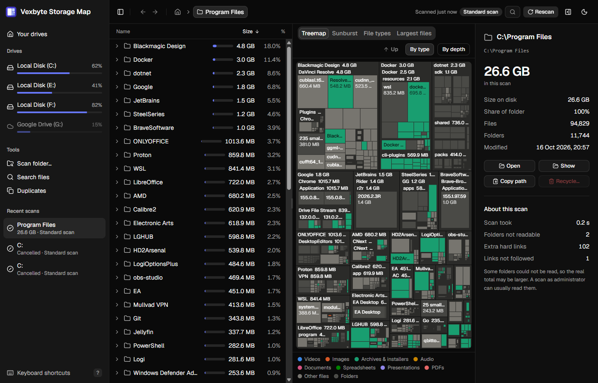
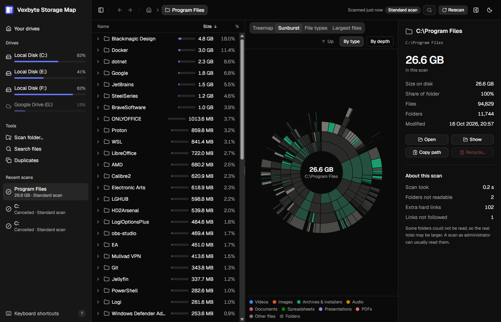
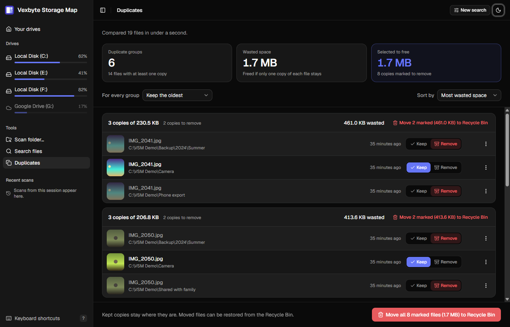
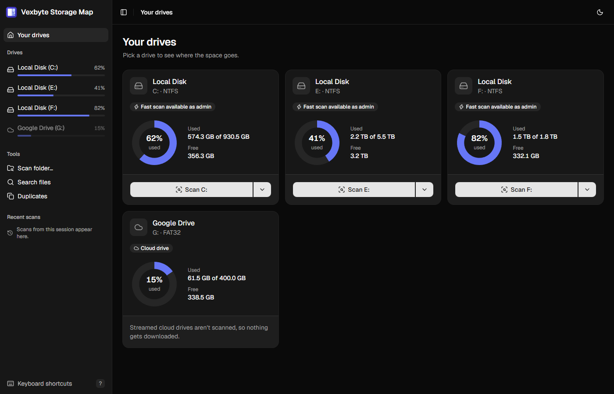
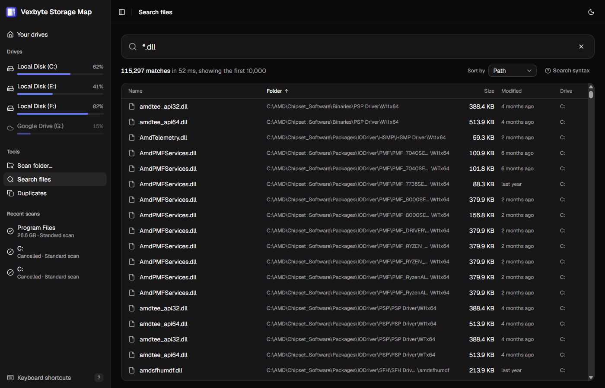

<div align="center">


# Vexbyte Storage Map

**See where your disk space went, then safely clean it up. A fast disk space explorer with a built-in duplicate finder.**

[](https://github.com/Azmekk/vexbyte-storage-map/releases/latest)
[](https://github.com/Azmekk/vexbyte-storage-map/actions/workflows/ci.yml)

[](#license)

[**Website**](https://storagemap.vexbyte.com/) · [**Download**](https://github.com/Azmekk/vexbyte-storage-map/releases/latest) · [Features](#features) · [Search syntax](#search-syntax) · [Safety](#safety) · [Building](#building-from-source)

<picture>
  <source media="(prefers-color-scheme: light)" srcset="docs/screenshots/treemap-light.png">
  
</picture>

</div>

**VSM** scans a drive or folder and shows you where the space goes: a sortable tree, a zoomable treemap, a sunburst, a file type breakdown and a largest-files list. On NTFS drives it can read the Master File Table directly, so scans finish in seconds. The duplicate finder looks through your Pictures, Videos, Music, Documents and Downloads for exact copies and lets you review them with thumbnails before anything moves to the Recycle Bin (the Trash on Linux).

> [!NOTE]
> **Pre-release.** Runs on Windows 10 and 11 (64-bit) and x64 Linux. There is no macOS build yet; one may come in the future.

## Features

<table>
<tr>
<td width="50%" valign="top">

### ⚡ Scans in seconds
Two scan methods: a parallel folder walk that works everywhere, and an MFT reader for NTFS drives (admin required) that is many times faster.

### 🗺️ See the space
Treemap and sunburst views rendered on canvas with animated zoom, plus a virtualized tree table, breadcrumbs, an inspector panel and a file type breakdown.

### 🔍 Instant search
Find any file or folder on every local drive by name or path in milliseconds, in the spirit of Everything (<kbd>Ctrl</kbd>+<kbd>Shift</kbd>+<kbd>F</kbd> or <kbd>F3</kbd>). The index is built in the background when the app starts and kept in memory.

</td>
<td width="50%" valign="top">

### 🧬 Duplicate finder
Finds exact copies of images, videos, audio, PDFs, Office documents and archives using size grouping, partial hashing and BLAKE3 full hashing. Keep rules (oldest, newest, preferred folder, shortest path) and a review screen with shell thumbnails.

### ♻️ Undoable by design
Everything destructive goes to the Recycle Bin, one file, one group or every marked copy at once, always after a confirmation that lists exactly what moves.

### ☁️ Cloud-aware
OneDrive and other online-only files count only what is actually on the disk, and are never downloaded. Dark and light themes, reduced-motion support and keyboard shortcuts (press <kbd>?</kbd> in the app).

</td>
</tr>
</table>

<table>
<tr>
<td width="50%"><div align="center"><sub>Sunburst coloured by file type</sub></div></td>
<td width="50%"><div align="center"><sub>Duplicate finder with keep and remove choices</sub></div></td>
</tr>
<tr>
<td width="50%"><div align="center"><sub>Home screen with drive cards</sub></div></td>
<td width="50%"><div align="center"><sub>Global search across every indexed drive</sub></div></td>
</tr>
</table>

## Download

Get the latest version from the [**website**](https://storagemap.vexbyte.com/) or the [**Releases page**](https://github.com/Azmekk/vexbyte-storage-map/releases/latest):

| File | What it is |
|---|---|
| `Vexbyte.Storage.Map_X.Y.Z_x64-setup.exe` | **Windows installer.** Windows 10 and 11, 64-bit. |
| `Vexbyte.Storage.Map_X.Y.Z_amd64.deb` | Debian 12+, Ubuntu 22.04+ and derivatives. |
| `Vexbyte.Storage.Map-X.Y.Z-1.x86_64.rpm` | Fedora, RHEL 10. |
| `Vexbyte.Storage.Map_X.Y.Z_amd64.AppImage` | Any x64 distro (Arch included). Make it executable and run it. |

Linux builds are made on Ubuntu 22.04.

<details>
<summary><b>Windows SmartScreen says "Windows protected your PC"</b></summary>

The builds aren't code-signed yet, so SmartScreen doesn't recognise them. Click **More info → Run anyway**. Every release is built from this repository by [GitHub Actions](https://github.com/Azmekk/vexbyte-storage-map/actions/workflows/release.yml).
</details>

## Search syntax

The Search screen understands a subset of Everything's syntax:

| Example | Matches |
|---|---|
| `annual report` | names containing all the words |
| `"annual report"` | the exact phrase |
| `*.iso`, `img_????.png` | wildcards |
| `photos\2024` | path terms |
| `holiday ext:jpg;png size:>2mb` | filters: `ext:`, `size:`, `type:`, `file:` and `folder:` |

Click **Search syntax** in the app for more examples, or read the full reference in [docs/SEARCH.md](docs/SEARCH.md).

## Safety

> [!IMPORTANT]
> **Scans are read-only.** The only action that changes anything on disk is **Move to Recycle Bin**, and everything it moves can be restored.

- Both scan methods open drives and folders for reading only.
- Cloud placeholder files (OneDrive "online-only" files) are never opened, so nothing gets downloaded. They are never counted as space either: a placeholder adds only the bytes it has on this disk, and placeholders without any local data stay out of the tree unless you show them.
- Streamed cloud drives such as Google Drive for desktop are recognized and never scanned or searched for duplicates, because reading them would download their files.
- **Move to Recycle Bin** (from the explorer or the duplicates screen) always shows a confirmation dialog listing exactly what will move.
- The duplicate finder re-checks every file right before moving it and always keeps at least one copy.

## Building from source

You need Rust 1.99+, Node 24+, [pnpm](https://pnpm.io/), and:

- **Windows:** Visual Studio Build Tools with the C++ workload, WebView2 (ships with Windows 11).
- **Linux (Debian/Ubuntu):** `sudo apt install build-essential curl wget file libwebkit2gtk-4.1-dev libxdo-dev libssl-dev libayatana-appindicator3-dev librsvg2-dev`. Other distributions: see the [Tauri prerequisites](https://v2.tauri.app/start/prerequisites/).

```bash
pnpm install
pnpm tauri dev      # run the app with hot reload
pnpm tauri build    # installer in target/release/bundle/ (the workspace target folder)
```

Checks:

```bash
pnpm check && pnpm typecheck && pnpm test
cargo fmt --check && cargo clippy --workspace --all-targets && cargo test --workspace
```

Before a release, walk through the [manual test checklist](docs/MANUAL_TESTING.md): both scan methods including the elevated relaunch, OneDrive placeholders, exFAT drives, a duplicate search on a hard disk and the Recycle Bin flows on a temporary folder.

**Tech:** Tauri 2, Rust (edition 2024), React 19, TypeScript, Tailwind CSS v4, shadcn/ui, d3-hierarchy, Motion, Zustand, Biome, Vitest.

<details>
<summary><b>Releasing</b></summary>

Pushing a tag such as `v0.1.0` runs the frontend checks, builds the app and publishes the installers as a GitHub release named "Vexbyte Storage Map v0.1.0" (0.x versions are marked as pre-releases). Builds are unsigned; Authenticode signing can be added with `bundle.windows.certificateThumbprint` or `bundle.windows.signCommand` in `src-tauri/tauri.conf.json`.
</details>

<details>
<summary><b>Download page</b></summary>

[`site/`](site/) is the download page at [storagemap.vexbyte.com](https://storagemap.vexbyte.com/), served by Cloudflare Workers using [`site/wrangler.jsonc`](site/wrangler.jsonc).
</details>

<details>
<summary><b>Replacing the icon</b></summary>

The app icon is a placeholder. To replace it, swap `src-tauri/icons/icon-source.png` (1024 × 1024 PNG) and regenerate the sizes with `pnpm tauri icon src-tauri/icons/icon-source.png`; also update `public/favicon.png`, which the sidebar shows.
</details>

The full implementation plan lives in [PLAN.md](PLAN.md).

## License

MIT
